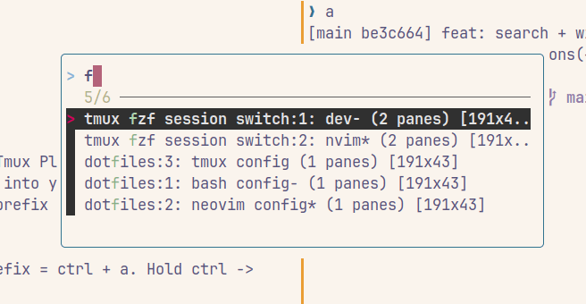

# TMUX FZF Claude Window Switch



## Features

This is a customized tmux session/window/pane switcher optimized for Claude Code workflows:

1. **Chord-based filtering**: `Ctrl+K` is a chord prefix — press a sub-key to filter by window name
   - `Ctrl+K` → `c` — panes in windows named `claude`
   - `Ctrl+K` → `s` — panes in windows named `server`
   - `Ctrl+K` → `i` — panes in windows named `index`
   - `Ctrl+K` → `t` — panes in windows named `test`
   - `Ctrl+K` → `h` — [hub mode](#hub-mode)
   - `Ctrl+K` → `l` — [tidy](#tidy-ctrlk--l) the hub layout of the current pane's project
   - Any other key after `Ctrl+K` — silently exits (tmux default behavior)
2. **Pane-level switching**: Switch directly to specific panes, not just windows
3. **Clean display format**: aligned columns with Claude's working/idle status and time since the last message
   - Example: `working  12s ago  dictaphone  0.1  Project Structure`
4. **No-prefix keybinding**: Default is `Ctrl+K` (no prefix required)
5. **Fuzzy search** with fzf for fast navigation
6. **Create new sessions** if the name doesn't exist
7. **Hub mode**: `Ctrl+K` → `h` opens the [cc-hub](#hub-mode) picker (projects, coordinators, threads) in a popup
   - Claude panes that belong to a hub project get a dim `hub:<project>` or `hub:<project>/<thread>` tag
     in the `Ctrl+K` → `c` switcher
   - `Ctrl+K` → `l` runs `hub tidy` for the current pane's project: coordinator left, threads stacked right
8. **[Window colours](#window-colours-for-claude-sessions)**: a window's entry in the status bar turns
   yellow when a Claude session in it needs your input, and green when one finished while you were away

### Why this fork?

This fork is specifically designed for Claude Code users who:
- Work with multiple tmux sessions running Claude, servers, or test runners
- Want instant access to any specific window type across all sessions
- Prefer a cleaner, more focused display showing only relevant windows
- Need a fast, keyboard-driven workflow without prefix keys

### Display Format

The switcher shows one pane per row under a pinned column header. Claude panes are sorted by most recent
activity; other panes follow with the first two columns blank:
```
STATUS   LAST MSG  SESSION                 PANE  TITLE
working  12s ago   tmux-fzf-claude-switch  5.1   Claude pane message timer
idle     4m ago    tmux-wrangler           4.1   Tmux session name collision
idle     1h ago    iv-pro-baby             4.1   Push remaining changes
```

- `STATUS`: `working` (yellow) while Claude is running, `idle` (dim) when it is waiting for you.
- `LAST MSG`: time since the last user or assistant message (green under 10m, dim past 1h).
- `SESSION`: each tmux session gets its own colour, the same in every popup.
- `PANE`: `<window-index>.<pane-index>` within the session.

Press `ctrl-s` to switch the order between `recent` (Claude panes by last activity) and `session`
(alphabetical); the prompt shows the active order. While you type, fzf ranks rows by match quality instead.

The status and age come from Claude Code's session registry (`~/.claude/sessions/<pid>.json`, whose `tmux` field
records the pane ID) and the tail of that session's transcript (`~/.claude/projects/*/<sessionId>.jsonl`).
`CLAUDE_CONFIG_DIR` is respected. The `session:window.pane` switch target is carried in a hidden fzf field, so
it is not shown or searched.

## Hub mode

`hub` is a CLI that runs Claude Code "projects": a coordinator session plus background thread
sessions that share a memory. Bare `hub` opens an fzf picker of every project with its
coordinator and threads, in the style of `claude agents`.

Press `Ctrl+K` then `h` (the same chord as `c`/`s`/`i`/`t`) from anywhere in tmux to open that
picker in a popup.
The popup runs `hub --tmux`: choosing a session switches to the tmux pane where it is already
open, or opens a new tmux window running it, and the popup closes.

- Needs a `hub` that supports `--tmux` (its `hub help` lists `--tmux`). hub is looked up on the
  popup's `PATH`, then at `$CLAUDE_HUB/bin/hub` and `~/claude-hub/bin/hub`. If it is missing or
  too old, the popup says so and waits for a key.
- The popup is sized to the picker. `hub --tmux-size <maxcols> <maxrows>` is asked how much room the
  picker needs (inside the border) and the popup is opened at that size, never larger than the
  width/height options below, which are maximums. A hub without `--tmux-size` (not in its `hub help`),
  or one that fails, prints something unexpected or takes over 2 seconds, gets the maximum size.
- `CLAUDE_HUB` (the hub root, default `~/claude-hub`) is passed through, including when it is only
  set in the tmux environment (`tmux set-environment -g CLAUDE_HUB ...`).
- In the `Ctrl+K` → `c` switcher, a Claude pane whose session is a hub coordinator (`<project>-coord`)
  is tagged `hub:<project>`, a thread (`<project>--<slug>`) `hub:<project>/<slug>`, and any other
  session started inside `$CLAUDE_HUB/projects/<project>` `hub:<project>`. The tag is dim, sits at
  the start of the title and can be searched (type `hub:`). Without a hub install nothing changes.

### Resolved projects

Resolved hub projects belong to hub mode only. Use `Ctrl+K` → `h` to see, resolve or reopen them
(ctrl+r and ctrl+d in the hub picker).

The `Ctrl+K` → `c` switcher has no resolved-project features: it does not read
`$CLAUDE_HUB/projects/<project>/.archived`, has no `ctrl-r` key (fzf binds none, so it does nothing) and no
`resolved` tag. `hub resolve <project>` closes the project's tmux panes, so they leave the list. A
pane of a resolved project that is still open is listed like any other pane, with its normal
`hub:<project>` tag.

The options `@fzf-claude-show-resolved` and its older name `@fzf-claude-show-archived` were
removed. Setting them now does nothing (and causes no error), so they can be deleted from
`.tmux.conf` at any time.

Hub mode (`Ctrl+K` → `h`) is not filtered by the plugin: `hub --tmux` decides what its picker shows.

Options (defaults shown):

```bash
set -g @fzf-claude-hub-key 'h'                 # '' or 'off' disables hub mode
set -g @fzf-claude-tidy-key 'l'                # Ctrl+K then this key runs hub tidy; '' or 'off' unbinds it
set -g @fzf-claude-hub-table 'chord'           # chord: Ctrl+K then the key; prefix: prefix + key;
                                               # root: the key alone, no prefix
set -g @fzf-claude-hub-autosize 'on'           # 'off' always opens the popup at the maximum size
set -g @fzf-claude-hub-width '90%'             # maximum popup width: a % of the client or columns
set -g @fzf-claude-hub-height '85%'            # maximum popup height: a % of the client or rows
```

In the chord table, pick keys other than `c`, `s`, `i` and `t` (and different hub and tidy keys), or
the later binding replaces the earlier one.
`@fzf-claude-hub-without-prefix 'true'`, from earlier versions, still works and means `root`; an
explicit `@fzf-claude-hub-table` wins over it. To keep the old `prefix + h`:

```bash
set -g @fzf-claude-hub-table 'prefix'
```

On each load the plugin first removes the hub and tidy bindings it made before (in any of the three
tables), so changing a key or table, turning hub mode off, or upgrading from `prefix + h` leaves
nothing stale behind. A key of your own (one that does not run this plugin's hub scripts) is never
unbound. The key options need a plugin reload (`tmux source ~/.tmux.conf` or `prefix + I`). The
size options are read each time you press the key.

### Tidy (`Ctrl+K` → `l`)

`hub tidy <project>` rebuilds a project's layout in one go: the coordinator on the left, its live
thread panes stacked in one column on the right, panes of finished threads closed, heights evened
out. `Ctrl+K` then `l` runs it for the project of the pane you are in, and shows what hub printed as
a tmux message. The project is found from, in this order:

1. the pane's `@hub_thread` tag (`<project>--<slug>` or `<project>-coord`; hub sets it on the thread
   panes it opens),
2. a thread pane whose `@hub_coord` is this pane (this pane is the coordinator they were split from),
3. the name of the Claude Code session running in the pane (`<project>-coord` or `<project>--<slug>`),
4. the tmux window name, then the session name, in the same form.

A name only counts when `$CLAUDE_HUB/projects/<project>` exists. If none matches, the message says the
pane is not part of a hub project. If hub is missing, or its `hub help` does not list `hub tidy` yet,
the message says so (`update hub: hub tidy not available`) and nothing else happens. The key never
leaves the pane in view-mode, so the next key you press works as usual.

## Window colours for Claude sessions

The window list in the status bar (`8:cc-hub-coord` ...) shows which windows need you:

| Colour | Meaning | Clears when |
|--------|---------|-------------|
| yellow | a Claude session in the window waits on you: a permission prompt, a question (AskUserQuestion) or another dialog; or a background hub thread is blocked | the session works again (you answered) |
| green | a Claude session in the window finished its turn while you were not looking at the window | you open the window (also when that session starts working again or exits) |

When one window has both, yellow wins. A session that finishes in the window you are looking at does
not turn it green. Only the window-list entry changes: no pane borders, pane titles or window names.
It works for every Claude Code session in tmux, hub or not, and needs no Claude Code hooks or
settings.

**How it works.** Claude Code keeps a registry file for each live session,
`~/.claude/sessions/<pid>.json` (or `$CLAUDE_CONFIG_DIR/sessions`). It holds the session's `status`:
`busy`, `idle`, or `waiting` with `waitingFor` (for example `"permission prompt"` or
`"input needed"`), plus `statusUpdatedAt`. A background session (`claude --bg`) writes the same
`waiting` on a permission prompt, and also has `~/.claude/jobs/<jobId>/state.json`: `tempo` is
`blocked` on a prompt, and `state` is `blocked` when the thread ended its turn blocked on a decision.
All of these were seen on Claude Code 2.1.322.
`scripts/claude_attn.sh` reads these files in one loop per tmux server (every 2 seconds, started by
the plugin) and sets the window option `@claude_attn` to `input`, `done`, or unsets it.

- An interactive session belongs to the window of its pane (the `tmux` value in its registry file).
  Its process must run on that pane's tty, so a pane with the same id in another tmux server is
  never coloured.
- A background session (`"tmux":null`, for example a hub thread) belongs to every window with a pane
  whose `@hub_thread` option is the session's name. hub sets that option on the attach panes it opens.
- "Done" needs no history: each window keeps `@claude_attn_seen`, the newest `statusUpdatedAt` of its
  sessions the last time you had the window in view (the active window of a session with a client
  attached). A window is green when one of its sessions is idle with a newer time than that. A
  session that is idle since start-up is never "done". When the plugin starts, idle sessions do not
  turn green.
- Hooks on `session-window-changed`, `client-session-changed` and `client-attached` (slots 71 and 72
  of each hook array, so your own hooks stay) clear green at once when you open a window.
- The colour goes in front of `window-status-format` and `window-status-current-format` as a
  conditional style on `@claude_attn`. The rest of your format stays as it is. A reload takes out the
  old prefix before it adds the new one. A theme that puts its own `#[...]` styles in these formats
  can override the colour. Then set `@fzf-claude-attn-format off` and use `#{@claude_attn}` in your
  own format.
- One check costs 2 tmux commands and one awk pass over the registry files, about 30 ms. `ps` only
  runs when a new session shows up. It never runs once per window.

Options (set them before the plugin loads, or reload with `prefix + I`):

```bash
set -g @fzf-claude-attn 'off'                          # turn it all off: formats, hooks, loop
set -g @fzf-claude-attn-format 'off'                   # keep @claude_attn, leave your formats alone
set -g @fzf-claude-attn-input-style 'bg=yellow,fg=black'   # default
set -g @fzf-claude-attn-done-style 'bg=black,fg=green'     # default (the default status bar is green)
set -g @fzf-claude-attn-interval '2'                   # seconds between checks
```

Your own format can use the option directly, for example:

```bash
set -g window-status-format '#{?#{==:#{@claude_attn},input},#[fg=yellow],}#I:#W'
```

## Requirements

- [Tmux >= 3.3a](https://github.com/brokenricefilms/tmux-fzf-session-switch/pull/5/files) `pop-up menu`
- [fzf >= 0.53](https://github.com/junegunn/fzf) (for `--highlight-line`)

## Getting started

- Install the [tpm](https://github.com/tmux-plugins/tpm) Tmux Plugin Manager.
- Put `set -g @plugin 'yourusername/tmux-fzf-claude-switch'` into your tmux config
- Use tpm to install this plugin. Default you can press `prefix + I` (`I` is
  `shift + i` = I)
- **Default keybinding**: `Ctrl + K` (chord prefix, no tmux prefix required)
  - Press `Ctrl + K` to enter the chord, then press a sub-key:
    | Sub-key | Filter |
    |---------|--------|
    | `c` | windows named `claude` |
    | `s` | windows named `server` |
    | `i` | windows named `index` |
    | `t` | windows named `test` |
    | `h` | [hub mode](#hub-mode) (the cc-hub picker) |
    | `l` | [tidy](#tidy-ctrlk--l) the hub layout (`hub tidy <project>`) |
    | any other key | exits silently |
  - Type to fuzzy search through the filtered list
  - Press Enter to switch to the selected pane
- If you type a name that doesn't exist, you will be prompted to create it.

> If this name conflicts with another session name -> add a double/single quotes `'example'`

## Tests

`tests/run.sh` drives the plugin in throwaway tmux servers (sockets `hubmodetest` and
`hubmodetest-outer`, `-f /dev/null`), so your own tmux server and config are not touched. It checks
the key bindings, `hub_mode.sh` with stub `hub` executables, real `Ctrl+K` `h`/`c`/`s` presses through
an attached client, the hub tag, that resolved hub projects get no special treatment in the switcher
(their panes listed normally, `ctrl-r` unbound, no `resolved` text, the removed options ignored;
with the real fzf too when it is installed), `ctrl-s`, the
`Ctrl+K` `l` tidy key with stub hubs against a fake `CLAUDE_CONFIG_DIR`, and the window colours
(stand-in Claude processes in panes with a fake registry: yellow and green on the rendered status
line, clearing on work and on a real `prefix` + window key, hub thread attach panes, other-server pane
ids, your formats kept, reloads, opt-out, no loop left behind). Every test server reads an empty
`CLAUDE_CONFIG_DIR`, never your real `~/.claude`. Run it with both bashes, since tmux
`run-shell` may use macOS's bash 3.2:

```bash
bash tests/run.sh
/bin/bash tests/run.sh
```

## Customize

> 🫰Thanks to [@erikw](https://github.com/erikw)

### Key binding

```bash
set -g @fzf-goto-session 'key binding'
```

> Eg. to override the default session switcher in tmux available at `prefix` + s`:

```bash
set -g @fzf-goto-session 's'
```

#### Without prefix

The default is now `true` (no prefix required). To require a prefix:

```bash
set -g @fzf-goto-session-without-prefix 'false'
```

### Window dimensions

```bash
set -g @fzf-goto-win-width WIDTH
set -g @fzf-goto-win-height HEIGHT
```

> Eg.

```bash
set -g @fzf-goto-win-width 70
set -g @fzf-goto-win-height 20
```

## Tips

### Use in command line

```bash
function tmuxSessionSwitch() {
  session=$(tmux list-windows -a | fzf | sed 's/: .*//g')
  tmux switch-client -t "$session"
}
```

```bash
function tmux_kill_uname_session() {
  echo "kill all unname tmux session"
  cd /tmp/
  tmux ls | awk '{print $1}' | grep -o '[0-9]\+' >/tmp/killAllUnnameTmuxSessionOutput.sh
  sed -i 's/^/tmux kill-session -t /' killAllUnnameTmuxSessionOutput.sh
  chmod +x killAllUnnameTmuxSessionOutput.sh
  ./killAllUnnameTmuxSessionOutput.sh
  cd -
  tmux ls
}
```

> use with `clear` command is the best

```
alias clear='tmux_kill_uname_session ; clear -x'
```

### Easy to press

- In my use case, I don't use this keybinding for switch sessions, I use `hold space + ;` mapping for `hold Ctrl + a + f`
- How can I use `hold space + ;` mapping?
  -> I use [input remapper](https://github.com/sezanzeb/input-remapper), also you can see [my dotfiles](https://github.com/brokenricefilms/dotfiles)

> config in GUI

```python
space: if_single(key(KEY_SPACE), ,timeout=10000)
space + semicolon: KEY_RIGHTCTRL+a+f
```

![input remapper][img_input_remapper]

[img_input_remapper]: ./img/input_remapper.png
